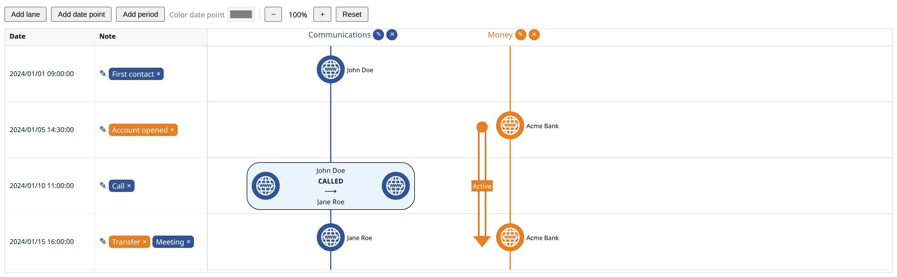

# vue-project



## Using the library

Install it together with its peer dependencies:

```sh
npm install vue-timeline-svg vue pinia
```

Pinia does not need to be installed on your app (`app.use(createPinia())` is optional). Each `<Timeline>` keeps its own state, so several can be used on one page.

```vue
<template>
  <Timeline v-model:data="data" @node-click="onNodeClick" />
</template>

<script setup lang="ts">
import { ref } from 'vue'
import { Timeline, createTimelineData } from 'vue-timeline-svg'
import 'vue-timeline-svg/style.css'

// Build the timeline from raw events; rows are created and sorted for you
const data = ref(
  createTimelineData(({ setLanes, addNodeEntity, addRelationEntity, setPeriods }) => {
    setLanes([
      {
        id: 'lane-1',
        name: 'Communications',
        color: '#2F5597',
        datePointsColor: '#2F5597',
        periodColor: '#2F5597',
        filters: { vertices: [], edges: [] },
      },
    ])
    addNodeEntity('2024/01/01 09:00:00', 'lane-1', 'v-1', 'First contact', 'John Doe')
    addRelationEntity(
      { id: 'e-1', source: 'John Doe', target: 'Jane Roe', label: 'CALLED', property: 'Call', value: '2024/01/10 11:00:00' },
      'lane-1',
    )
  }),
)

const onNodeClick = ({ laneId, vertexId }: { laneId: string; vertexId: string }) => {
  console.log(laneId, vertexId)
}
</script>
```

Dates use the `YYYY/MM/DD HH:mm:ss` format. To register the component globally instead, call `app.use(TimelinePlugin)` and use `<VTimeline />`.

### Props

| Prop | Type | Description |
|---|---|---|
| `data` | `TimelineData` | Lanes, rows, periods and lane positions. Use with `v-model:data`. |
| `confirmDelete` | `(message: string) => boolean` | Called before a lane or period is deleted. Defaults to `window.confirm`. |

### Events

| Event | Payload | Description |
|---|---|---|
| `update:data` | `TimelineData` | Emitted with a fresh copy whenever the user changes the timeline. |
| `node-click` | `{ laneId, vertexId }` | Emitted when a date point is selected. |

### Exposed methods

Through a template ref: `addNodeEntity(dateTime, laneId, id, timestampProperty, entityName)`, `addRelationEntity(relation, laneId)` and `deleteLane(laneId)`.

### Building the library

```sh
npm run build:lib   # outputs dist/ (ES + UMD bundles, style.css, type declarations)
npm publish         # runs type-check and build:lib first
```

## Development

This template should help get you started developing with Vue 3 in Vite.

## Recommended IDE Setup

[VS Code](https://code.visualstudio.com/) + [Vue (Official)](https://marketplace.visualstudio.com/items?itemName=Vue.volar) (and disable Vetur).

## Recommended Browser Setup

- Chromium-based browsers (Chrome, Edge, Brave, etc.):
  - [Vue.js devtools](https://chromewebstore.google.com/detail/vuejs-devtools/nhdogjmejiglipccpnnnanhbledajbpd) 
  - [Turn on Custom Object Formatter in Chrome DevTools](http://bit.ly/object-formatters)
- Firefox:
  - [Vue.js devtools](https://addons.mozilla.org/en-US/firefox/addon/vue-js-devtools/)
  - [Turn on Custom Object Formatter in Firefox DevTools](https://fxdx.dev/firefox-devtools-custom-object-formatters/)

## Type Support for `.vue` Imports in TS

TypeScript cannot handle type information for `.vue` imports by default, so we replace the `tsc` CLI with `vue-tsc` for type checking. In editors, we need [Volar](https://marketplace.visualstudio.com/items?itemName=Vue.volar) to make the TypeScript language service aware of `.vue` types.

## Customize configuration

See [Vite Configuration Reference](https://vite.dev/config/).

## Project Setup

```sh
npm install
```

### Compile and Hot-Reload for Development

```sh
npm run dev
```

### Type-Check, Compile and Minify for Production

```sh
npm run build
```

### Run Unit Tests with [Vitest](https://vitest.dev/)

```sh
npm run test:unit
```

### Run End-to-End Tests with [Playwright](https://playwright.dev)

```sh
# Install browsers for the first run
npx playwright install

# When testing on CI, must build the project first
npm run build

# Runs the end-to-end tests
npm run test:e2e
# Runs the tests only on Chromium
npm run test:e2e -- --project=chromium
# Runs the tests of a specific file
npm run test:e2e -- tests/example.spec.ts
# Runs the tests in debug mode
npm run test:e2e -- --debug
```

### Lint with [ESLint](https://eslint.org/)

```sh
npm run lint
```
